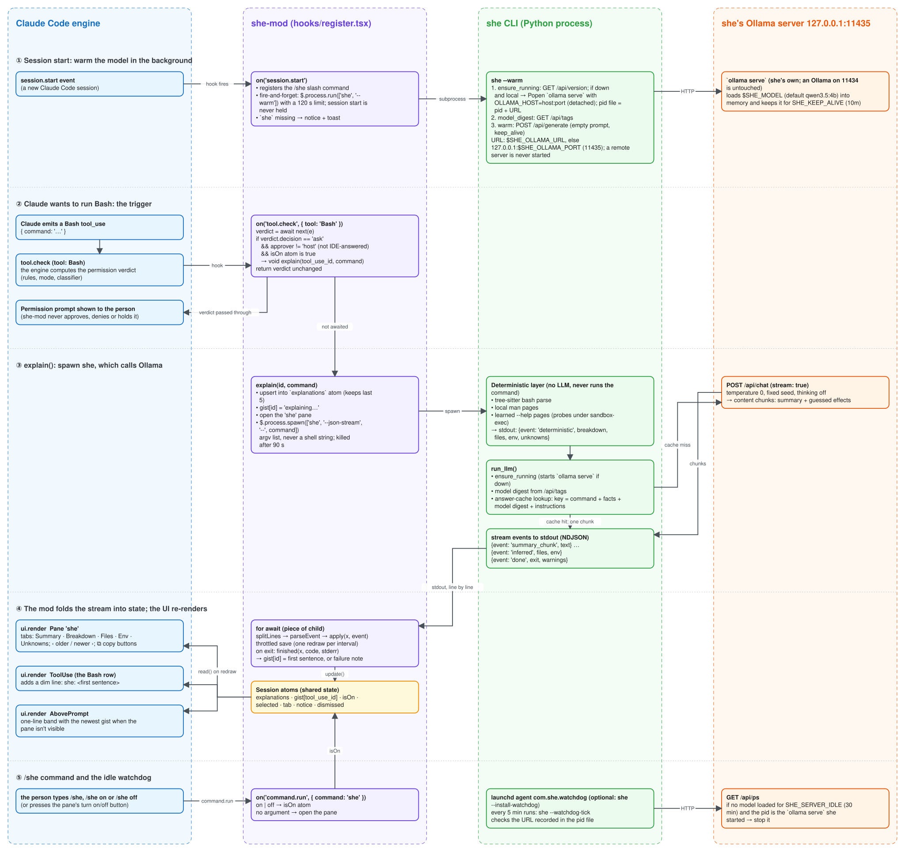

# she — shell explain

`she` explains a shell command in plain English. A deterministic layer (tree-sitter parse,
local man pages, learned `--help` pages) prints a breakdown instantly; a small local LLM
(Ollama) then streams a short summary and guesses at effects the syntax doesn't show.
It never runs the command it explains.

The full specification is in [CLI_CONTRACT.md](CLI_CONTRACT.md).

## Install

Requires macOS, Python ≥ 3.12 and [uv](https://docs.astral.sh/uv/). `she` does not ship
or download a model: you install Ollama and choose one yourself (step 1).

### 1. Ollama and a model

Install [Ollama](https://ollama.com), then pull a model. Any chat model Ollama runs will
do; `qwen3.5:4b` (about 4 GB) is the default `she` was tuned on:

```sh
ollama pull qwen3.5:4b
```

To use another model, pull it and point `she` at it (add the line to `~/.zshrc`):

```sh
ollama pull gemma3:4b
export SHE_MODEL=gemma3:4b        # or per call: she --model gemma3:4b -- '...'
```

Ollama keeps the weights in `~/.ollama/models`, or in `$OLLAMA_MODELS` when that is set
(set it before Ollama starts, e.g. to keep models on another disk). A model from a local
GGUF file works too once Ollama knows it: `ollama create mymodel -f Modelfile`, then
`SHE_MODEL=mymodel`.

### 2. `she` and the Claude Code mod

One line installs a released `she` and, if Claude Code is installed, the mod. It then
reports whether Ollama and your model are ready:

```sh
curl -fsSL https://raw.githubusercontent.com/AviadKlein/shell-explain/v0.2.0/install.sh | sh
```

Or the same by hand:

```sh
uv tool install "git+https://github.com/AviadKlein/shell-explain@v0.2.0"
claude plugin install she-mod --marketplace AviadKlein/shell-explain
```

Inside a Claude Code session the mod's line is
`/plugin install she-mod --marketplace AviadKlein/shell-explain` (answer `y` to add the
marketplace, then pick the user scope). The mod starts working in new sessions; it needs
`she` on `PATH`.

In the mod's pane, the `⧉` buttons copy a file's full path, an env variable (`NAME=value`),
or the command wrapped as `she -- '<command>'`, so pasting it explains the command
instead of running it.

The pane keeps the last 5 explanations (`‹ older` / `newer ›`); set `SHE_PANE_HISTORY`
(1 to 50) in the environment Claude Code starts in to keep more or fewer.

`/she` opens the pane; `/she off` stops new explanations for the rest of the session and
`/she on` resumes them (the pane has the same switch). To turn the mod off for good:
`claude plugin disable she-mod`.

`she` runs its own Ollama server on port 11435 (`SHE_OLLAMA_PORT`), separate from an
Ollama you use on the usual 11434, so other clients can't change its `keep_alive`, context
length or loaded model. Both servers read the same downloaded models. To use an Ollama
on another machine instead, set `SHE_OLLAMA_URL`. The command you're explaining is sent
there unredacted, and Ollama has no authentication, so use an SSH tunnel or a private
network rather than an open port. The mod's `she` reads these variables from the
environment Claude Code was started in.

### 3. Check

```sh
she --status
```

It says `No Ollama installed` or `Model required: …` when something is missing, and
otherwise where the model's weights are and how to remove them.

### Updating and removing

#### Updating
```sh
uv tool install --force "git+https://github.com/AviadKlein/shell-explain@v0.3.0"   # a newer tag
claude plugin marketplace update shell-explain                                     # newer mod
```

#### Removing `she`
```sh
uv tool uninstall shell-explain
claude plugin uninstall she-mod
```

#### Don't forget to remove the Ollama weights from disk if you don't need it anymore
```sh
ollama rm qwen3.5:4b              # frees the model's disk space
```

## How the mod works

[](docs/she-mod-flow.excalidraw)

The diagram traces which Claude Code events the mod hooks (`session.start`, `tool.check`
for Bash, `command.run`, `ui.render`), the `she` processes it spawns, and the HTTP calls
`she` makes to the Ollama server. Its source is
[docs/she-mod-flow.excalidraw](docs/she-mod-flow.excalidraw). To edit it, open the file at
[excalidraw.com](https://excalidraw.com) (menu → Open), then re-export the SVG next to it.

## CLI Usage

```sh
she -- 'find . -name "*.tmp" -delete && export CLEANED=1'
she -- 'git log --pretty=format:'\''%h %an %ad %s'\'' --date=short | head -5; echo '\''---'\''; find . -path ./.git -prune -o -type f -not -name '\''*.ipynb'\'' -print0 | xargs -0 wc -l 2>/dev/null | sort -rn | head -10; echo '\''---'\''; ls -la | awk '\''NR>1 {sum+=$5} END {print "total bytes:", sum}'\'''
she --parse-only -- 'tar -czf out.tgz src'      # no LLM, ~100 ms
she --json -- 'git log --graph --oneline'       # she/v1 JSON
she --json < commands.sh                        # one JSON list; heredocs stay whole
she --warm                                      # start Ollama and load the model
```

Put the command after `--` so its flags are never read as `she` flags.

## Flags

| Group | Flags |
|---|---|
| Explain | `--parse-only`, `--list` (files only), `--list-env` (env only), `--json`, `--json-stream`, `--no-learn`, `--no-cache`, `--model NAME`, `--instructions FILE`, `--timeout SEC` |
| Help pages | `--parse-cli TOOL [--depth N]`, `--has-pages TOOL`, `--forget TOOL[@VERSION]`, `--list-tools` |
| Server | `--warm`, `--status`, `--clear-cache`, `--install-watchdog`, `--uninstall-watchdog` |
| Instructions | `--edit-global-instructions`, `--edit-local-instructions`, `--show-instructions` |

Exit codes: 0 ok, 1 internal error, 2 usage error, 3 parse error, 4 LLM unavailable or timed out
(`No Ollama installed`, `Model required`, or a timeout; the reason is on stderr).

## Environment

| Variable | Default |
|---|---|
| `SHE_MODEL` | `qwen3.5:4b`; any model you pulled into Ollama |
| `SHE_OLLAMA_PORT` | `11435`: the port of she's own local Ollama server, which she starts when it's down |
| `SHE_OLLAMA_URL` | (unset) a full URL, e.g. a remote `http://gpu-box:11434`; wins over `SHE_OLLAMA_PORT`. she only starts servers on this machine |
| `OLLAMA_MODELS` | `~/.ollama/models`: Ollama's own setting, where model weights live; `she --status` reads it |
| `SHE_KEEP_ALIVE` | `10m` |
| `SHE_INSTRUCTIONS` | (unset) a file path or literal instructions text |
| `SHE_CACHE_TTL` | `7` (days) |
| `SHE_CACHE_MAX_MB` | `50` |
| `SHE_PANE_HISTORY` | `5`: how many explanations the mod's pane keeps (1 to 50) |
| `SHE_SERVER_IDLE` | `30` (minutes, for the watchdog) |
| `SHE_CACHE_DIR` / `SHE_STATE_DIR` / `SHE_CONFIG_DIR` | `~/Library/Caches/she`, `~/Library/Application Support/she`, `~/.config/she` |

## Development

```sh
uv sync
uv run pytest
uv tool install .                        # your working copy as `she`
claude plugin test she-mod               # the mod's tests
claude --plugin-dir she-mod              # a session with the working-copy mod
```

## Releasing

Bump `version` in `pyproject.toml` and `src/she/__init__.py` (and `she-mod/.claude-plugin/plugin.json`
for a mod change), update the tag in `install.sh` and this README, commit, then
`git tag -a vX.Y.Z -m 'she X.Y.Z' && git push origin vX.Y.Z`.
